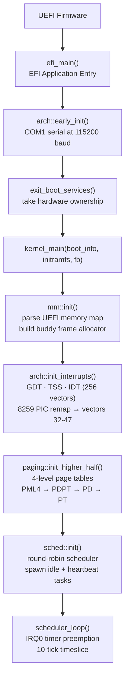
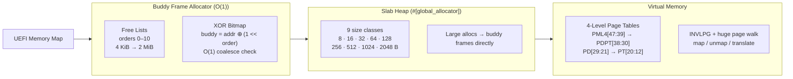
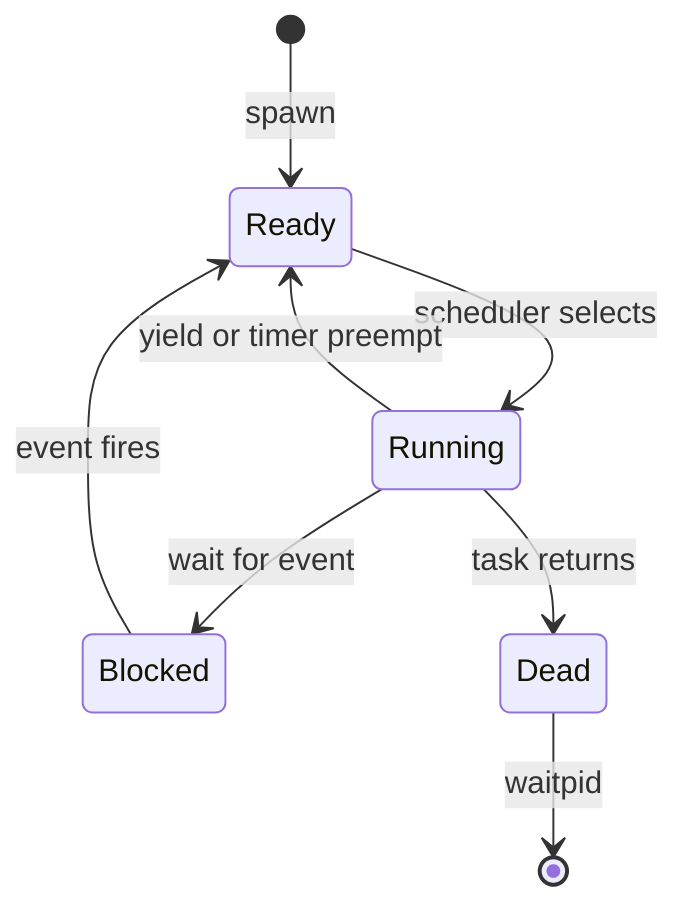

# Eithne

An x86_64 operating system kernel written in Rust, booting via UEFI firmware. Implements the full low-level foundation: memory management, interrupt handling, virtual memory, and a preemptive round-robin scheduler with assembly context switching.

```
[eithne] kernel booting...          [mm]  buddy allocator ready — 20535 free pages (80 MiB)
[gdt]   loaded — CS=0x8 TSS=0x28   [idt] loaded at 0x605d2b0
[pic]   IRQ0 (timer) unmasked       [sched] spawned task TaskId(2) 'heartbeat'
[eithne] initialization complete — entering scheduler loop.
```

---

## Boot & Initialization Sequence



---

## Memory Subsystem



**Buddy allocator:** Allocation pops from the appropriate order's free list, splitting down if needed. Deallocation coalesces with the buddy (found via XOR) recursively up to `MAX_ORDER`. All O(1) amortized.

**Slab heap:** Each size class maintains an intrusive free list stored directly in the free slots. Allocations under 2,048 bytes never touch the buddy allocator — O(1) with no fragmentation.

---

## Interrupt & Exception Handling

256-entry IDT with hand-written assembly stubs for every vector:

| Vectors | Purpose |
|---|---|
| 0–31 | CPU exceptions — divide error, page fault, double fault, GPF, … |
| 32–47 | 8259 PIC IRQs (remapped from legacy 8–15) |
| 48–255 | Reserved |

Every exception stub pushes a full `InterruptFrame` (15 GPRs + vector + error code + CPU-pushed RIP/CS/RFLAGS/RSP/SS) and prints a register dump to COM1. Page faults additionally decode CR2.

**IST stacks:** Double-fault and NMI use dedicated IST stacks from the TSS — a GPF inside the exception handler won't triple-fault.

---

## Scheduler

Cooperative + preemptive round-robin. The IRQ0 timer fires at ~18.2 Hz; after 10 ticks the current task is preempted.



**Context switch** (`switch_context` in assembly): saves callee-saved registers (RBX, RBP, R12–R15) and RSP onto the current task's kernel stack; loads the next task's RSP and pops its saved state. `iretq` restores RIP, CS, RFLAGS, RSP, SS — returning into the new task wherever it last yielded or was preempted.

Each task gets a **64 KiB kernel stack** allocated from the buddy allocator.

---

## Synchronization Primitives

| Type | Mechanism |
|---|---|
| `Spinlock<T>` | `AtomicBool` test-and-set, busy-wait |
| `IrqSpinlock<T>` | Spinlock + save/restore `RFLAGS.IF` — safe across interrupt boundaries |
| `Once<T>` | `AtomicU8` state machine (uninit → initializing → initialized) — one-time global init |

---

The `ArchPlatform` trait abstracts early init, interrupt control, serial output, and halt — x86_64 is fully implemented; aarch64 and riscv64 have typed stubs for future porting.

---

## Building & Running

**Requirements:** Rust nightly (pinned via `rust-toolchain.toml`) · QEMU · OVMF (`edk2-ovmf`)

```bash
cargo build              # compile UEFI kernel binary
./run.sh                 # assemble ESP image and boot in QEMU
```

Press `Ctrl-B X` to exit QEMU.
